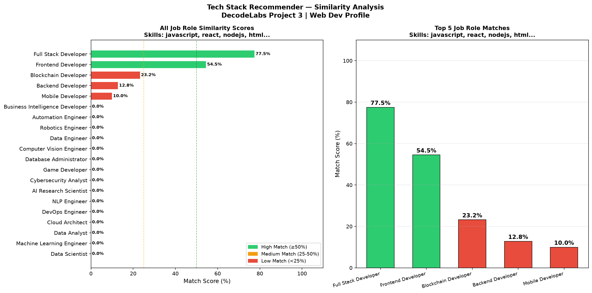

# Job Role Recommender

Content-based recommender that matches a user's skills to the most relevant job roles using TF-IDF vectors and cosine similarity. Built for the DecodeLabs AI Industrial Training (Batch 2026), Project 3.



## What It Does

- Loads a dataset of 20 job roles with their skill tags (`raw_skills.csv`, 121 unique skills)
- Converts skills to TF-IDF vectors, so rare skills carry more weight than common ones
- Scores every role against the user's skills with cosine similarity
- Returns the top matches with a match percentage
- Shows matching skills and skills still to learn for each role
- Requires at least 3 skills as input (a simple cold-start guard)
- Provides an interactive terminal mode and similarity charts, including a multi-profile comparison

## How It Works

1. **Ingestion:** capture and normalize the user's skills.
2. **Scoring:** calculate cosine similarity against every role.
3. **Sorting:** rank by similarity score.
4. **Filtering:** return only the top N results.

## Design Choices

- **Content-based filtering** needs only the role catalog, not historical user data.
- **TF-IDF** instead of binary vectors, so specific skills count for more than generic ones.
- **Cosine similarity** instead of Euclidean distance, so profile length does not distort the score.

## Dataset

| Property | Value |
|---|---|
| File | `raw_skills.csv` |
| Roles | 20 |
| Unique skill tags | 121 |
| Format | `job_role, skills` (space-separated tags such as `machine_learning`) |

## Run

Requires Python 3.7 or newer.

```bash
git clone https://github.com/ash-1212/job-role-recommender.git
cd job-role-recommender
pip install -r requirements.txt
python recommender.py
```

In interactive mode, enter one skill per prompt and type `done` when finished:

```
Skill 1: python
Skill 2: machine_learning
Skill 3: sql
Skill 4: done
```

Type `exit` to quit.

## Output Files

| File | Description |
|---|---|
| `similarity_data_science_profile.png` | Chart for a data science profile |
| `similarity_web_dev_profile.png` | Chart for a web development profile |
| `multi_profile_comparison.png` | Comparison across several profiles |

## Concepts Practiced

- Content-based filtering
- TF-IDF vectorization
- Cosine similarity
- Handling the cold-start problem with a minimum-input rule
- Top-N filtering

## Author

**Ayesha Nazish**
DecodeLabs AI Industrial Training, Batch 2026.
[GitHub](https://github.com/ash-1212) · [LinkedIn](https://www.linkedin.com/in/ayeshanazish-452048274)